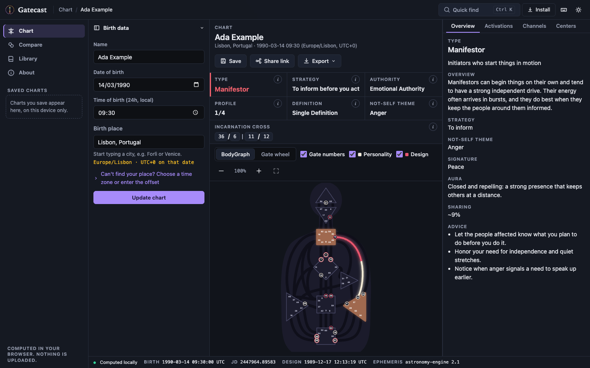
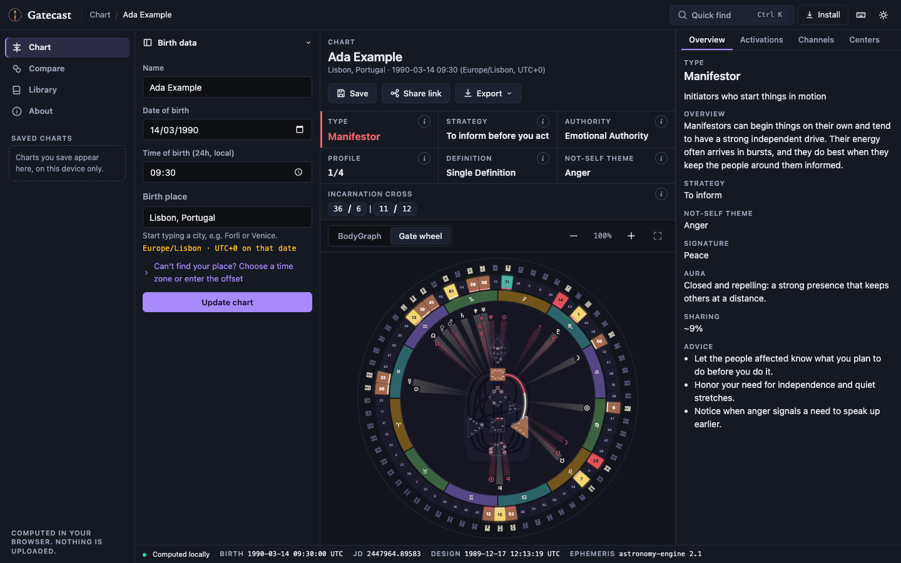
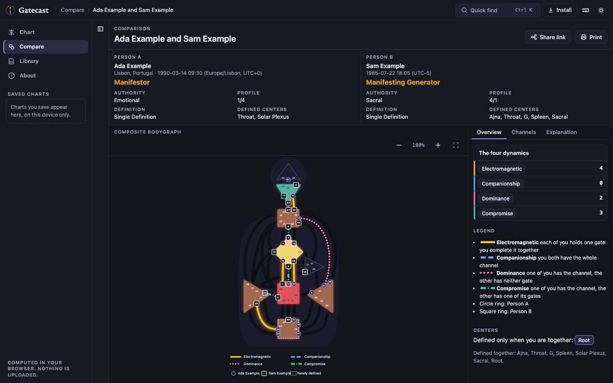
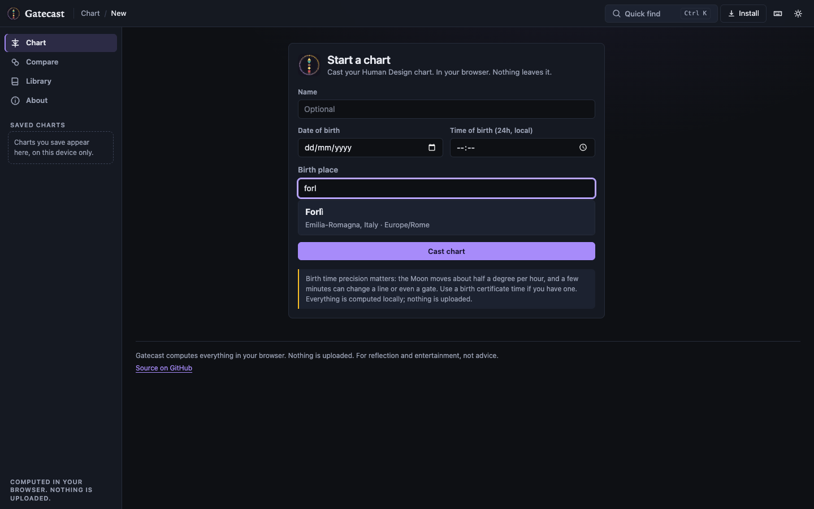
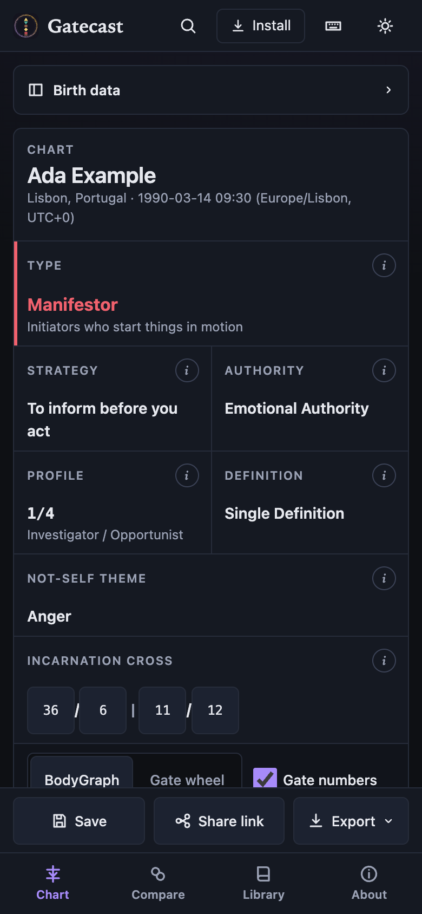

<p align="center">
  
</p>

<h1 align="center">Gatecast</h1>

<p align="center">
  <strong>Cast your Human Design chart. In your browser. Nothing leaves it.</strong>
</p>

<p align="center">
  <a href="https://github.com/alex-quiterio/gatecast/actions/workflows/ci.yml"></a>
  <a href="https://alex-quiterio.github.io/gatecast/"></a>
  
  
  
</p>

<p align="center">
  
</p>

Gatecast computes a Human Design chart from a birth date, time and place, and explains every part of it:
the BodyGraph, the gate wheel, Type, Strategy, Authority, Profile, centers, channels and gates. Compare two
people (electromagnetic, companionship, dominance and compromise dynamics) and browse the whole system in a
searchable library, with an info tooltip on everything.

**Live: <https://alex-quiterio.github.io/gatecast/>**

## Highlights

- **Private by design.** Everything is computed in your browser. There is no server, no analytics and no
  network call except loading the site's own files. Saved charts live in `localStorage`, on your device.
- **Real astronomy.** Planetary positions come from
  [astronomy-engine](https://github.com/cosinekitty/astronomy) (MIT, arcminute accurate). The engine is
  checked against the Swiss Ephemeris, see [How accuracy is tested](#how-accuracy-is-tested).
- **Search a city, not a time zone.** Type "Forlì", "Venezia" or "Amsterdam": the place sets the time zone,
  and the offset for that date (daylight saving included) is shown. 34,000 cities, searched in a few
  milliseconds, with a time zone and manual-offset fallback.
- **A workstation, not a landing page.** App bar with quick find (`Ctrl/Cmd + K`), saved charts in a left
  rail, a three-pane chart workspace with zoom and pan, an inspector with tabs, and a status bar showing the
  birth moment, Julian day and Design moment, so the numbers are auditable.
- **Installable and offline.** A PWA: install it from Chrome (desktop and Android) or Add to Home Screen on
  iOS. After the first visit it works without a network, including city search.
- **Shareable.** A chart or a comparison is a link. The birth data lives in the URL hash, which browsers
  never send to a server. Export a chart as JSON, SVG or PNG, copy a text summary, or print.
- **Mobile first.** Bottom tab bar, touch-sized targets, the BodyGraph before the facts, pinch to zoom.
- **Fully typed.** Strict TypeScript from the maths to the DOM, with [Preact](https://preactjs.com) for the UI.

<p align="center">
  
  
</p>
<p align="center">
  
  
</p>

## Develop

Requires [Bun](https://bun.sh) 1.3 or newer.

```sh
bun install
bun run dev      # build and serve http://localhost:3000, rebuilding on change
bun run check    # typecheck, lint, format check and tests (what CI runs)
bun run build    # static site in dist/
```

| Script                 | What it does                                   |
| ---------------------- | ---------------------------------------------- |
| `bun run dev`          | Builds, serves `dist/` and rebuilds on change  |
| `bun run build`        | Bundles the app, service worker and styles     |
| `bun run test`         | Runs the unit, component and cross-check tests |
| `bun run typecheck`    | `tsc --noEmit` with strict settings            |
| `bun run lint`         | ESLint (typescript-eslint, strict)             |
| `bun run format`       | Prettier, writing changes                      |
| `bun run format:check` | Prettier, check only                           |

The service worker registers only on a real host. On `localhost` it stays off so development is not cached;
open `http://localhost:3000/?sw=1` to try offline mode and the install prompt.

## How it is organised

```
src/
  types.ts      shared contract: Chart, Comparison, Activation...
  engine/       ephemeris, gate wheel, BodyGraph logic, chart and comparison maths
  content/      every meaning, name and tooltip text
  places/       city search: normalising, ranking, formatting, time zones
  ui/           SVG renderers (BodyGraph, wheel, composite), Preact views and components
  pwa.ts        install prompt, update flow and service worker registration
  sw.ts         the service worker
scripts/        build, dev server, and the city dataset generator (Bun)
public/         logo, icons, manifest and places.json
test/           unit, component and Swiss Ephemeris cross-check tests
```

The engine has no DOM dependency and the SVG renderers return strings, so the maths and the drawing are
unit-tested without a browser. Components stay thin: parsing, validation, search, ranking and zoom logic live
in plain modules (`form-logic`, `search-logic`, `canvas-logic`, `router`, `share`, `storage`) with their own
tests. Folders import each other through aliases (`@engine`, `@content`, `@ui`, `@/`), and ESLint rejects
`../` imports.

## How accuracy is tested

A Human Design chart has two moments: the **Personality** (birth) and the **Design**, when the Sun was
exactly 88 degrees of arc earlier (about 88 days before birth). Each of the 13 bodies is placed on one of
the 64 gates (5.625 degrees each) and one of its six lines (0.9375 degrees each).

`test/fixtures/swisseph-reference.json` holds positions computed with the Swiss Ephemeris for 30 invented
birth moments between 1931 and 2025. The test suite checks the TypeScript engine against it: every body is
within 0.0072 degrees, and gates, lines, Type, Authority and Profile agree except where a body sits right on
a line boundary (those are skipped on purpose and counted). A line boundary is a hard edge: a few arcminutes of
difference, or a birth time that is a few minutes off, can move a planet into the next line or gate. That is
true of every Human Design tool. If your chart differs from another tool, compare the Profile and defined
centers, and check your birth time first.

## Data, icons and screenshots

- **Cities.** `public/places.json` is generated by `bun scripts/build-places.ts` from GeoNames
  `cities15000` (about 34,000 places). The script validates every time zone and fails if a must-find city
  (Venice, Forlì, Amsterdam, Rome, Lisbon, São Paulo, Zürich, Mumbai/Bombay...) resolves wrongly. The file is
  about 640 KB gzipped, loaded the first time the place box gets focus, then cached offline.
- **Icons and screenshots.** The PNG icons (192, 512, maskable 512, 180 Apple touch) are rendered from
  `public/logo.svg` in headless Chrome. The screenshots in `public/screenshots` (the install dialog) and
  `docs/screenshots` (this README) are captured from the built site with an invented person.

## Deploy

Pushing to `main` runs [`.github/workflows/ci.yml`](.github/workflows/ci.yml): typecheck, lint, format check,
tests and build, then `dist/` is deployed to GitHub Pages. In a fork, enable it under
**Settings → Pages → Source: GitHub Actions**. All URLs are relative, so it works under the `/gatecast/`
project path.

## Credits

- Astronomical calculations: [astronomy-engine](https://github.com/cosinekitty/astronomy) by Don Cross, MIT.
- City data: [GeoNames](https://www.geonames.org), licensed
  [CC BY 4.0](https://creativecommons.org/licenses/by/4.0/). Reduced to names, countries and time zones.
- UI: [Preact](https://preactjs.com), MIT.

## Disclaimer

Human Design is a system for self-reflection. It is not science, and it is not medical, psychological,
financial or legal advice. Use it as a prompt for curiosity, not as a verdict about who you are.

## License

[MIT](LICENSE).
